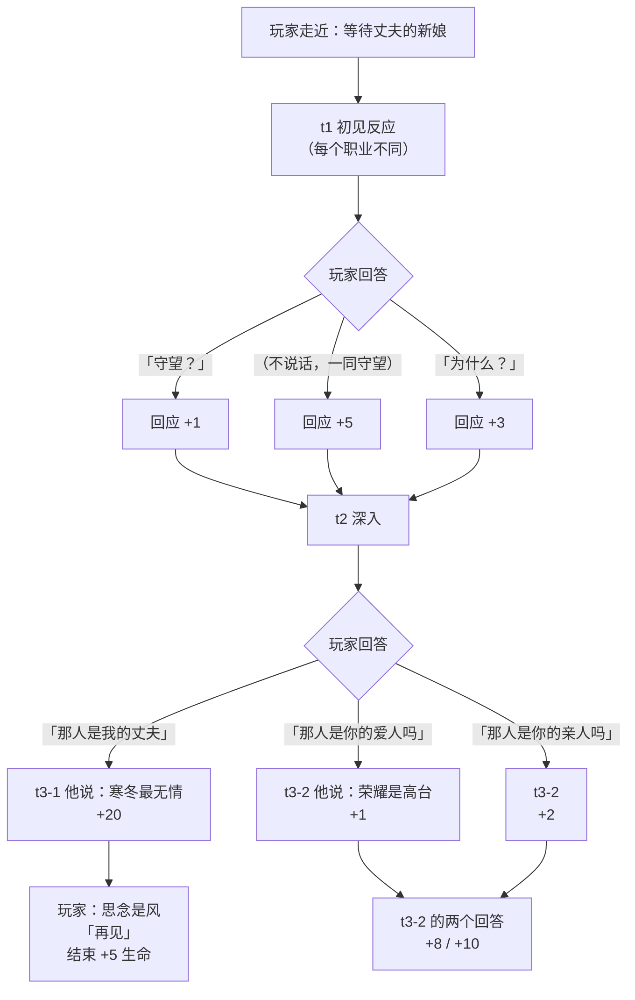
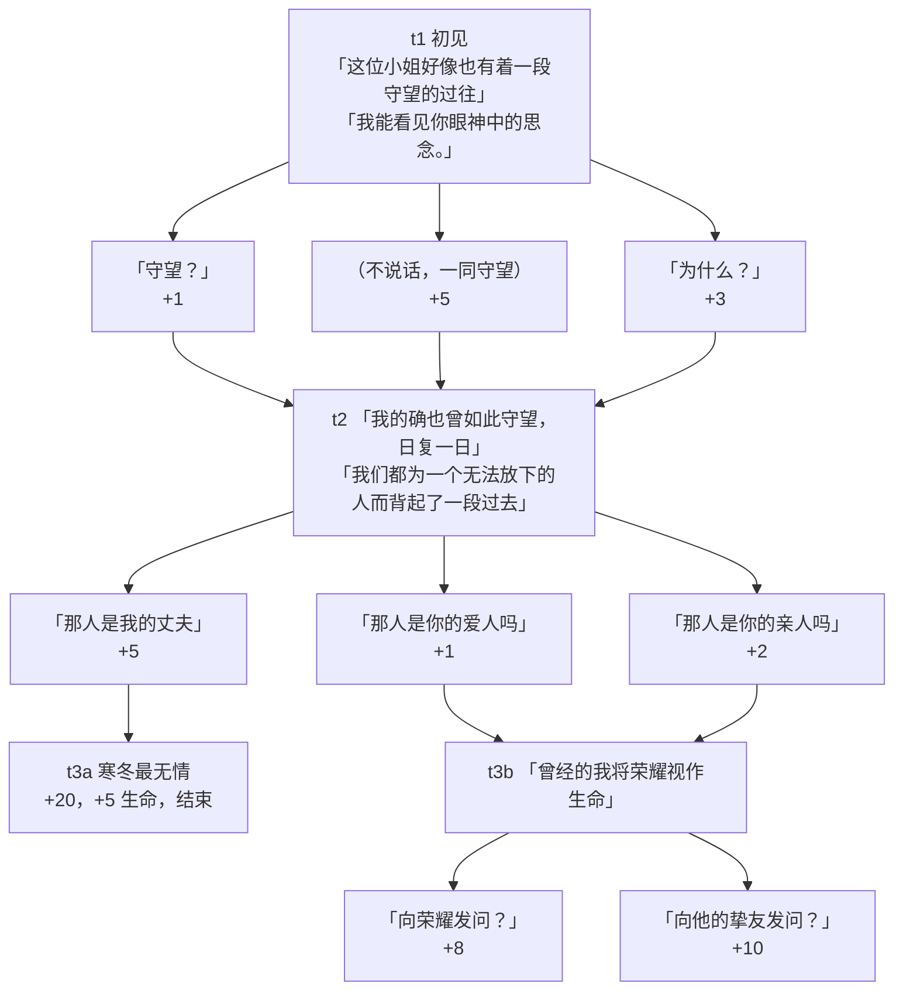
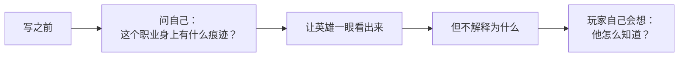
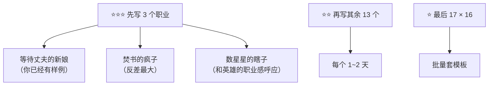

# 对话分支写作手册

> 目标：**16 个职业 × 18 个英雄 = 288 种见面对话**，每种都不同。
> 这份文档用**思维导图 + 表格**的形式，让你能直接看着写。

---

## 一、先看结构（三层）



**三层就够**：初见 → 深入 → 分叉/结束。再长玩家记不住。

---

## 二、数据怎么写（对应 `npc_db.gd`）

```gdscript
"阿喀琉斯": {
	"topics": [
		{
			"id": "t1",
			"label": "「（走近）」",
			"action": "他看了你一眼，又回过头看向远方。",
			"text": "默认台词（职业没写时用这个）",
			"vocation_lines": {
				"等待丈夫的新娘": "他看了你一眼\n「这位小姐好像也有着一段守望的过往」\n「我能看见你眼神中的思念。」",
				"焚书的疯子": "……",
			},
			"responses": [
				{"label": "「守望？」", "text": "「没错，女士…」", "favor": 1},
				{"label": "（不说话，尝试与他一同守望）", "text": "他只是轻轻看了你一眼。", "favor": 5},
				{"label": "「为什么？」", "text": "「当一个人踌躇于他的过往时…」", "favor": 3},
			],
		},
		{
			"id": "t2",
			"requires": {"topics": ["t1"]},
			"text": "「呼~」\n「他长舒了一口气。」",
			"responses": [
				{"label": "「那人是你的爱人吗」", "text": "「我并无爱人」", "favor": 1},
				{"label": "「那人是你的亲人吗」", "text": "「并不是」", "favor": 2},
				{"label": "「那人是我的丈夫」", "text": "他没说话。\n只是静静等候着下文", "favor": 5, "next": "t3a"},
			],
		},
		{
			"id": "t3a",
			"text": "「女士，寒冬是最无情的季节。」\n「我为你丈夫的离去而悲伤。」",
			"responses": [
				{"label": "「感谢你的开解，但思念是风，我无法令它停止。」\n「再见。」", "text": "（你的眼角有泪滴凝聚）", "favor": 20, "heal": 5, "end": true},
			],
		},
		{
			"id": "t3b",
			"requires": {"topics": ["t2"]},
			"text": "「唉——无妨」\n「曾经的我将荣耀视作生命」",
			"responses": [
				{"label": "「向荣耀与曾经发问？」", "text": "「我的荣誉，我的胜利」", "favor": 8},
				{"label": "「向他的挚友发问？」", "text": "「他为我的愚蠢偏执而死。」", "favor": 10},
			],
		},
	],
}
```

### 回答能带的字段

| 字段 | 作用 | 例子 |
|------|------|------|
| `label` | 按钮文字 | 「守望？」 |
| `text` | 他的回应 | 「没错，女士…」 |
| `favor` | 好感变化 | `+1` / `-3` |
| `next` | **跳到某个话题** | `"next": "t3a"` |
| `end` | **结束对话** | `"end": true` |
| `heal` / `hp` | 回血 / 扣血 | `"heal": 5` |
| `cards` | 给牌 | `["誓约"]` |
| `moral` / `sin` | 道德 / 罪恶 | `"moral": 5` |

---

## 三、阿喀琉斯 × 等待丈夫的新娘（完整样例）



### t1 · 初见

| 项 | 内容 |
|----|------|
| 动作 | 他看了你一眼，又回过头看向远方。 |
| 台词 | 「这位小姐好像也有着一段守望的过往」<br>「我能看见你眼神中的思念。」 |

| 回答 | 他的回应 | 好感 |
|------|----------|------|
| 「守望？」 | 「没错，女士，我于此处守望远方。」<br>「以此来怀念我的挚友。」 | +1 |
| （不说话，尝试与他一同守望） | 他只是轻轻看了你一眼。<br>又望向远方微微叹气 | +5 |
| 「为什么？」 | 「当一个人踌躇于他的过往时」<br>「便会想要守望远方了」<br>「就好像我已经开始向前了」 | +3 |

### t2 · 深入

| 项 | 内容 |
|----|------|
| 动作 | 他长舒了一口气。 |
| 台词 | 「呼~」<br>「我们都为一个无法放下的人而背起了一段过去」<br>「我的守望或许只是片刻休憩。」 |

| 回答 | 他的回应 | 好感 | 走向 |
|------|----------|------|------|
| 「那人是你的爱人吗」 | 「我并无爱人」<br>「他是我的挚友」 | +1 | → t3b |
| 「那人是你的亲人吗」 | 「并不是，尽管我爱着他们」<br>「他是我的挚友」 | +2 | → t3b |
| 「那人是我的丈夫」 | 他没说话。<br>只是静静等候着下文 | +5 | → **t3a** |

### t3a · 丈夫线（结束）

| 项 | 内容 |
|----|------|
| 动作 | 他温和的与你对视。 |
| 台词 | 「女士，寒冬是最无情的季节。」<br>「我为你丈夫的离去而悲伤。」<br>「但四季轮转，就让这痛苦深埋于风雪，在春天，夏天，秋天继续向前吧。」 |

| 回答 | 结果 | 好感 |
|------|------|------|
| 「感谢你的开解，但思念是风，我无法令它停止。」<br>「再见。」 | （你的眼角有泪滴凝聚）<br>**结束对话，+5 生命** | +20 |

### t3b · 荣耀线

| 项 | 内容 |
|----|------|
| 动作 | 他朝来路看了一眼。 |
| 台词 | 「唉——无妨」<br>「曾经的我将荣耀视作生命」<br>「而荣耀是危险的高台」 |

| 回答 | 他的回应 | 好感 |
|------|----------|------|
| 「向荣耀与曾经发问？」 | 「我的荣誉，我的胜利」<br>「我是如此坚决的捍卫它」 | +8 |
| 「向他的挚友发问？」 | 「他为我的愚蠢偏执而死。」<br>他回答的很快。 | +10 |

---

## 四、18 位英雄 × 16 职业 的写法模板

每个英雄开一份，**每份 16 段**（一段一个职业）。模板：

```markdown
### 阿喀琉斯 × {职业名}

**t1 初见反应**（这个职业会让他想起什么？）
- 他看到你身上什么：______
- 他说：______
- 三个回答：⊕ 好 / ⊖ 坏 / ∅ 中性

**t2 深入**（他把哪件事说给你听？）
- 三个回答：一条通向 **专属结局**，两条通向 **通用追问**

**专属结局**（只有这个职业能问出来的事）
- 给多少好感：+15 ~ +20
- 结束时的额外效果：回血 / 给牌 / 掉血
```

### 这份表填什么

| 列 | 填什么 |
|----|--------|
| **他看到你身上什么** | 职业的**痕迹**（新娘=婚戒磨痕 / 焚书人=烟味 / 瞎子=看天的角度） |
| **他说** | 一句话点破，不解释 |
| **三个回答** | 顺着问 / 沉默 / 追问原因 |
| **专属结局** | 只有这个职业能触发的**特有分支** |

---

## 五、写的时候的几条规则



| 规则 | 说明 |
|------|------|
| **看得见，不解释** | 「你手上有烟味」比「你是焚书的疯子吧」好一百倍 |
| **三层就停** | 初见 → 深入 → 分叉，再深没人记得住 |
| **专属结局要给东西** | 好感 +15 以上，或者回血、给牌 |
| **通用线也要能走完** | 每个话题至少有 1 条路能结束对话 |
| **好感别给太快** | 一个话题最多 +5，专属结局才给 +20 |

---

## 六、优先级（先写哪几个）



**别一次写 288 段。** 先把阿喀琉斯的 16 个写完，其他英雄会快很多 —— 因为套路已经定了。

---

## 七、目前的引擎支持

| 能力 | 状态 |
|------|------|
| 每职业不同开场白 | ✅ `vocation_lines` |
| 回答后跳转指定话题 | ✅ `"next": "t3a"` |
| 回答后结束对话 | ✅ `"end": true` |
| 回答带回血 / 扣血 | ✅ `"heal": 5` / `"hp": -5` |
| 回答给牌 | ✅ `"cards": ["誓约"]` |
| 回答加道德 / 罪恶 | ✅ `"moral": 5` |
| 话题按好感 / 前提解锁 | ✅ `requires` |
| 好感分档的状态行 | ✅ `MOODS` |
